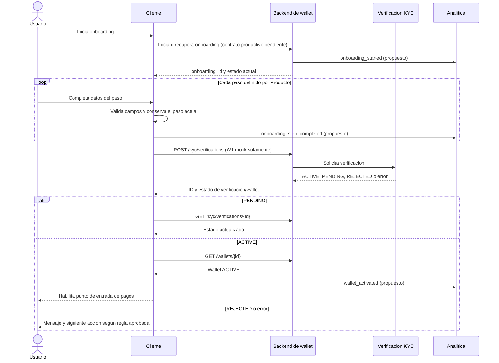

# Plan técnico: registro y activación del MVP de wallet

**Historia:** [Registro y activación del MVP de wallet](1-user-onboarding-mvp-completion.sp.md)
**Estado:** propuesta técnica para revisión; no aprobada para implementación.

## 1. Resumen ejecutivo y alcance

La historia requiere un recorrido de onboarding guiado, validación accionable, activación de wallet, medición de duración y eventos, además de insumos para reportar usuarios nuevos, MAU y CAC. La solución debe distinguir la finalización del onboarding (wallet activa) de la actividad posterior de pago (MAU).

Se propone mantener la secuencia visual y validaciones de formato en el cliente, y tratar los estados de verificación y wallet del backend como autoritativos. No se propone un endpoint nuevo para cada paso: el contrato W1 ya documenta iniciar y consultar una verificación y consultar la wallet. El progreso de pasos no está cubierto por ese contrato; persistirlo en servidor requiere confirmar que reanudar entre dispositivos o reinstalaciones forma parte del alcance.

El objetivo de reducir la mediana de 8 a 3 minutos es un resultado de negocio que se medirá, no una garantía de esta arquitectura. El mock existente no mide duración ni calcula MAU/CAC y no representa un proveedor KYC real.

**Dentro del alcance:** criterios de aceptación 1-6 de la historia, instrumentación propuesta del onboarding y sus dependencias para métricas.
**No se especifica aquí:** pasos de negocio concretos, documentación KYC, proveedor, política de límites, regla de atribución de campañas ni actividad que cualifica como usuario nuevo; requieren decisión humana.

## 2. Evidencia revisada y situación existente

| Evidencia | Hechos verificados |
|---|---|
| [Historia de onboarding](1-user-onboarding-mvp-completion.sp.md) | Define seis criterios, baseline de 8 minutos, objetivo de 3 minutos, cohorte Perú y pregunta abierta sobre timestamps de inicio y fin. Indica que KYC debe definirse con Producto y Cumplimiento. |
| [Épica](../epic/peru-wallet-mvp.sp.md) | El MVP incluye onboarding, pagos de bajo monto y QR; busca lanzar en un trimestre. La integración real con proveedores requiere acuerdos y habilitación operativa. |
| [W1 Registro y activación](../mockups/W1-Registro-y-activación.md) | Documenta `POST /kyc/verifications`, `GET /kyc/verifications/{id}`, `POST /kyc/verifications/{id}/decision` y `GET /wallets/{id}` para un mock. La verificación solo acepta datos ficticios `TEST-`; los escenarios incluyen aprobado, rechazado, revisión manual e indisponibilidad. Wallet nueva aprobada queda activa con saldo cero. |
| [Cobertura y límites de los mocks](../mockups/Cobertura-y-límites.md) | Los datos de los mocks son en memoria y pueden perderse. W1 no evita registros repetidos ni calcula duración, MAU, CAC o atribución; la aplicación debe implementar secuencia e instrumentación. Los mocks no tienen autenticación. |
| [Historia de pagos de bajo monto](2-payer-low-value-payment-confirmation.sp.md) | Las transacciones exitosas del pagador emiten el evento utilizado para calcular MAU. Por ello activar una wallet no basta para contar un usuario como activo mensual. |
| [Reglas del repositorio](../REGLAS.md) | Solicita pruebas de caracterización antes de cambios de persistencia/token, separación por capas y meta de cobertura de 85% o superior del código modificado. |
| [README del CrewAI](../../crewai/README.md) | Este repositorio contiene el orquestador de agentes que genera propuestas y código de ejemplo; no documenta un runtime de wallet desplegado. |

**Conclusión de evidencia:** no se encontró implementación de cliente/backend de wallet ni contratos de producción en el workspace. Las rutas W1 se tratan exclusivamente como contrato del mock de desarrollo. No se verificaron autenticación, persistencia de producción, servicio analítico ni integración KYC real.

## 3. Arquitectura propuesta y responsabilidades

| Componente | Responsabilidad propuesta | Situación |
|---|---|---|
| Cliente móvil | Mostrar pasos requeridos y paso actual; validar campos antes de avanzar; presentar errores recuperables; abrir la experiencia de pagos solo cuando el estado consultado de wallet sea `ACTIVE`. | A implementar; no hay cliente de wallet verificado en el workspace. La lista y orden de pasos requieren definición de Producto. |
| Servicio/backend de onboarding y wallet | Asociar verificación y wallet al usuario autenticado; aplicar las reglas de negocio aprobadas; exponer el estado autoritativo; evitar que el cliente active una wallet por cuenta propia. | Dependencia de producción no documentada. El mock W1 no autentica ni valida identidad real. |
| Servicio/proceso KYC | Producir un resultado de verificación de acuerdo con políticas aprobadas; manejar `PENDING`, `ACTIVE`/aprobado y `REJECTED` según el contrato acordado. | Proveedor, requisitos y estados deben confirmarse con Producto y Cumplimiento. |
| Persistencia | Conservar la relación usuario-verificación-wallet y el estado necesario para recuperar el onboarding. | El mock es en memoria. La tecnología y retención de producción no están verificadas. |
| Instrumentación analítica | Recibir eventos mínimos y deduplicables de inicio, pasos, cierre, activación y actividad de pago; servir datos con acceso restringido para el reporte. | No hay plataforma, contrato ni pipeline analítico verificado. Propuesta pendiente de selección/integración. |
| Pagos | Mantener la entrada de pagos inaccesible hasta wallet activa; emitir actividad exitosa según la historia de pagos para medir MAU. | El flujo de pagos está descrito por historias y mocks, no hay implementación productiva verificada. |

No se recomienda duplicar el estado de activación en el cliente ni inferirlo de que el usuario terminó de llenar un formulario. Si una wallet nueva tiene saldo cero, su activación habilita el punto de entrada de pagos pero no implica que un pago pueda completarse.

## 4. Flujo y modelo de estados

Los nombres de pasos son identificadores configurables, no una definición de requisitos KYC. Producto debe aprobar la secuencia y cuáles pasos son obligatorios antes de implementar.



**Estados propuestos del recorrido:**

| Estado | Significado y transición |
|---|---|
| `NOT_STARTED` | No se inició el flujo. Al iniciar, pasa a `IN_PROGRESS`. |
| `IN_PROGRESS` | Cliente muestra los pasos aprobados. Un dato inválido bloquea el avance y mantiene el paso actual; no cambia el estado de KYC. |
| `KYC_PENDING` | Backend informa verificación pendiente. Cliente informa que requiere espera/revisión y consulta estado cuando se reanude o mediante mecanismo que se acuerde. Transiciona a `ACTIVE` o `REJECTED` al conocer un resultado final. |
| `ACTIVE` | Wallet confirmada como activa por el backend. Permite entrar a pagos; no significa que exista saldo o que el usuario ya cuente como MAU. Estado terminal del onboarding. |
| `REJECTED` | Resultado final de rechazo. No permite pagos; el mensaje, apelación o reintento dependen de política por definir. |
| `RETRYABLE_ERROR` | Error de red o servicio sin resultado concluyente. Se conserva el estado conocido y se permite consultar/reintentar de forma segura; no se comunica como rechazo. |

El contrato W1 documenta estados de verificación/wallet y una decisión manual, pero no un estado persistido de cada paso de UI. Para reanudar, usar IDs de verificación/wallet y volver a consultar el backend si ya existen; el cliente no debe suponer que una respuesta perdida equivale a operación fallida. No almacenar documentos KYC en almacenamiento local. La reanudación tras pérdida del dispositivo requiere autenticación y recuperación asociada al usuario; ambas están pendientes de definición.

## 5. Contratos e integraciones

### Contratos verificados del mock W1

Estos contratos son para escenarios ficticios de desarrollo; **no son una especificación de producción**. El mock no autentica, no evita altas repetidas y restringe los documentos al prefijo `TEST-`.

| Operación | Entrada y salida documentadas | Errores/resiliencia |
|---|---|---|
| `POST /kyc/verifications` | JSON: `{"documentType":"TEST","document":"TEST-001","scenario":"APPROVED"}`. `scenario` opcional: `APPROVED`, `REJECTED`, `MANUAL_REVIEW`, `UNAVAILABLE`; predeterminado `APPROVED`. Respuesta indicada: `id`, `wallet_id`, `scenario`, `status`. Crea verificación y wallet de saldo cero. | HTTP `201`, `400`, `503`, `413`, `429`; `UNAVAILABLE` produce `503 KYC_UNAVAILABLE` sin crear wallet. El mock no deduplica solicitudes. No se documenta esquema de cuerpo de error ni encabezado de idempotencia. |
| `GET /kyc/verifications/{id}` | Respuesta: `id`, `wallet_id`, `scenario`, `status`. El ID es el de KYC, distinto de `wallet_id`. | `200`, `404 NOT_FOUND`. |
| `POST /kyc/verifications/{id}/decision` | JSON: `{"decision":"ACTIVE"}` o `{"decision":"REJECTED"}`. Solo decide una verificación pendiente y actualiza wallet/caso. | `200`, `400 INVALID_DECISION`, `404`, `409 DECISION_CONFLICT`, `413`, `429`. Repetir igual decisión devuelve `200`; cambiar decisión final devuelve `409`. Es operación de soporte/mock, no endpoint para el cliente final. |
| `GET /wallets/{id}` | Respuesta: `id`, `status`, `balance`, `reserved`, `available`, `currency`; importes en céntimos. | `200`, `404 NOT_FOUND`. No se documenta autenticación ni autorización en el mock. |

Ejemplo de desarrollo exclusivamente ficticio:

```http
POST /kyc/verifications
Content-Type: application/json

{"documentType":"TEST","document":"TEST-001","scenario":"MANUAL_REVIEW"}
```

La respuesta documentada incluye `id`, `wallet_id`, `scenario` y `status`; los valores concretos de `id` los asigna el mock. Para esta respuesta, consultar `GET /kyc/verifications/{id}`. No enviar información personal real al mock.

### Integración de producción propuesta

- Reutilizar las operaciones existentes de verificación/consulta/estado si el backend productivo ofrece capacidades equivalentes; no añadir rutas por paso de UI.
- Confirmar que la identidad autenticada queda vinculada a una sola verificación/wallet según reglas de negocio. El contrato del mock permite registros duplicados.
- Para iniciar KYC en producción, exigir autenticación y autorización sobre la identidad del solicitante. Los endpoints de decisión deben ser exclusivos de personal/servicio autorizado y auditados.
- Ante `POST` con respuesta perdida, la aplicación debe consultar si hay una verificación asociada antes de repetir. Si no puede recuperarla, el backend necesita una estrategia idempotente (por clave estable de operación o unicidad por usuario); comportamiento, retención y conflicto deben especificarse antes de lanzamiento. Esto es una propuesta, no una capacidad existente del mock.
- Los nombres exactos de estados y errores, esquemas de error, versionado, límites, timeouts y mecanismo de consulta asíncrona requieren contrato de producción. No se agregan aquí rutas nuevas porque W1 ya permite cubrir la comprobación de KYC y wallet en el mock.
- No existe contrato analítico verificado. Se propone emitir eventos de dominio por backend/outbox o mecanismo durable equivalente, con reintento y deduplicación; escoger transporte y destino es una decisión de arquitectura, no una API HTTP asumida.

## 6. Seguridad, KYC, privacidad y manejo de errores

**Controles existentes verificables:** el mock acepta exclusivamente `documentType=TEST` y `document` con prefijo `TEST-`; limita algunos errores HTTP y simula aprobación, rechazo, revisión manual e indisponibilidad. Estos controles protegen el escenario de prueba, no constituyen KYC ni seguridad de producción.

**Controles propuestos para producción:**

- Autenticar al usuario antes de iniciar o consultar su onboarding; autorizar por identidad y vínculo de wallet, no por conocer un ID.
- Autorizar decisiones de revisión manual a un rol operativo; registrar actor, fecha, resultado y motivo permitido, sin incluir documentos completos en auditoría analítica.
- Validar entradas en cliente para feedback y repetir validaciones de negocio en backend. La regla de campos obligatorios, formatos, mensajes y número de intentos debe venir de Producto/Cumplimiento.
- Cifrar datos sensibles en tránsito y en reposo según la plataforma aprobada; minimizar los datos almacenados y restringir acceso y retención. No registrar documentos, credenciales, tokens ni respuestas KYC completas en logs o analítica.
- Definir límites de intentos, protección contra automatización/abuso, retención/borrado y respuesta ante acceso indebido con Security y Cumplimiento.
- No presentar como aprobada una regla sobre documentos, biometría, sanciones, edad, elegibilidad o regulación: no hay evidencia suficiente en los documentos revisados.

| Condición/error | Comportamiento propuesto |
|---|---|
| Campo obligatorio ausente o inválido | Mantener paso actual, indicar campo y corrección concreta; no enviar avance al backend. Backend debe validar también los campos que gobiernan KYC. |
| `PENDING` / revisión manual | Mostrar que aún no está activa; mantener pagos bloqueados; consultar estado al reanudar o con frecuencia aprobada. No interpretar pendiente como rechazo. |
| `REJECTED` | Mantener pagos bloqueados y mostrar siguiente acción solo cuando Producto/Cumplimiento la definan. No permitir cambiar decisión final desde la app. |
| `503 KYC_UNAVAILABLE`, timeout o error de red | Mostrar indisponibilidad temporal y opción de reintento; no crear estado activo local ni iniciar una segunda verificación a ciegas. |
| `404` en una verificación/wallet guardada | Tratar como estado no recuperable de esa referencia; solicitar recuperación/autenticación o atención definida por Producto. No crear otra wallet automáticamente. |
| `409 DECISION_CONFLICT` | Para el flujo de soporte, recargar estado y elevar discrepancia; no insistir con una decisión distinta. No debería ser una operación de cliente. |
| Resultado exitoso sin respuesta al cliente | Consultar estado mediante ID disponible; si no se recibió ID, aplicar la estrategia idempotente de producción antes de repetir. |

## 7. Resiliencia, consistencia e idempotencia

- La activación es efectiva solo cuando la fuente autoritativa confirma wallet `ACTIVE`; el cliente no crea ni corrige ese estado.
- Una verificación `PENDING` no debe habilitar pagos. El resultado final del servicio KYC se refleja en la wallet de forma consistente y consultable. El mecanismo para propagar resultados asíncronos (consulta, callback o notificación) no está especificado y debe elegirse sin presuponer proveedor.
- Si se pierde la respuesta de inicio, no volver a crear una verificación hasta recuperar su resultado o aplicar idempotencia de backend. El mock W1 no resuelve duplicados; usarlo para pruebas de UX no demuestra idempotencia de producción.
- Las consultas de estado son reintentables; limitar frecuencia y aplicar espera incremental con jitter para no amplificar indisponibilidad. Los valores de timeout, backoff y límites deben configurarse según el servicio acordado.
- Registrar cambios de estado con identificador estable de verificación, versión/orden del estado y timestamp UTC para detectar estados atrasados o contradictorios. No aplicar eventos antiguos sobre un resultado terminal más reciente.
- Si analítica no está disponible, no bloquear la activación: persistir evento junto con el cambio de estado mediante outbox o mecanismo equivalente y reenviarlo. La entrega puede ser al menos una vez, por lo que el consumidor debe deduplicar.
- Si una revisión manual no se resuelve, mantener `PENDING` y ofrecer estado claro; definir SLA y escalamiento con Operaciones/Producto, no inventarlos en este plan.

## 8. Eventos y definiciones analíticas

### Catálogo propuesto

Campos comunes: `event_id` único; `event_name`; `occurred_at` UTC generado por servidor cuando el evento representa un cambio backend (cliente solo para interacción no transaccional); `user_id` seudónimo interno; `onboarding_id`/`attempt_id`; `flow_version`; `market` (`PE` para la cohorte, sujeto a fuente aprobada); `source`; y `schema_version`. Los campos identificativos se limitan a lo necesario. No incluir documentos, nombres, teléfono, credenciales, tokens ni respuesta KYC sin minimizar.

| Evento | Significado y momento | Campos específicos/deduplicación |
|---|---|---|
| `onboarding_started` | Se registra cuando el backend acepta el primer inicio del recorrido; punto inicial propuesto para la duración. | Un `event_id` por intento; clave de unicidad recomendada `(onboarding_id, event_name)`. Si el inicio ocurre solo en cliente, reportar esa limitación y no usarlo como métrica oficial sin validación. |
| `onboarding_step_completed` | Se registra después de validación exitosa y avance confirmado en cada paso obligatorio. | `step_id`, `step_order`, `completed_at`; unicidad `(onboarding_id, step_id, completion_sequence)`. Repetición del mismo evento no incrementa conteo. |
| `onboarding_validation_failed` | Medición opcional para localizar fricción; no reemplaza eventos requeridos. | `step_id`, `field_category`, `reason_code` controlado; nunca valor ingresado. Deduplicación por interacción/event ID. |
| `onboarding_resumed` | Se registra al continuar un intento ya iniciado que no llegó a estado terminal. | `onboarding_id`, `last_completed_step`; no reinicia el tiempo inicial. |
| `onboarding_closed` | Cierre exitoso al confirmarse wallet activa; una salida explícita antes de completar puede registrarse como `outcome=exited`. | `outcome`, `wallet_id` seudónimo; deduplicar por `onboarding_id` y resultado terminal. No se puede garantizar evento de salida ante cierre forzado de app. |
| `wallet_activated` | Cambio autoritativo de wallet a `ACTIVE`, después de verificación aprobada. | `wallet_id` seudónimo, `verification_id` seudónimo, timestamp de commit; único por wallet y transición a activa. Fuente backend. |
| `payer_payment_succeeded` | Actividad exitosa del pagador para MAU, según historia de pagos. Fuera del flujo de onboarding, dependencia de esa historia. | `user_id`, ID de pago seudónimo, estado exitoso terminal y timestamp. Deduplicar por ID de pago; una wallet cuenta una vez por mes. |
| `acquisition_attributed` (dependencia) | Asociación aprobada entre alta y campaña/fuente de adquisición, si aplica. | Código de campaña/canal y regla/ventana de atribución; nunca datos personales del anunciante/usuario en texto libre. No hay fuente definida. |

### Duración, abandono, usuarios y métricas

- **Duración oficial propuesta:** diferencia entre el primer `onboarding_started` aceptado por servidor y el primer cambio confirmado a wallet `ACTIVE`, vinculados por `onboarding_id`. Una reanudación conserva el inicio original. Se recomienda duración transcurrida (incluye esperas y pausas), no tiempo activo de pantalla; la frontera de inicio es una pregunta abierta de la historia y Producto debe aprobarla antes de comparar con la línea base.
- **Mediana:** por período/cohorte de inicio, ordenar duraciones de intentos completados en ese período y tomar la mediana; reportar cantidad de completados, percentiles y completitud de eventos. Excluir intentos todavía incompletos de la mediana, pero reportarlos por separado para evitar sesgo de supervivencia. Comparar con baseline de 8 minutos solo con la misma definición, cohorte, mercado y método de captura; fijar ventana, volumen mínimo y segmentación antes de evaluar los 3 meses.
- **Abandono:** no inferirlo por falta inmediata de evento. Un `exited` explícito puede medirse, pero cierres forzados se detectan solo como intentos iniciados sin activación al superar una ventana de inactividad que defina Producto/Analítica. Reanudaciones permanecen vinculadas al intento original; decidir cuándo un nuevo intento se considera separado.
- **Nuevos usuarios:** reportar por separado wallets activadas por primera vez en cada mes y usuarios con su primer pago exitoso. El criterio 6 no define cuál es el denominador “usuario nuevo”; propuesta para CAC: usuario único cuya wallet se activó por primera vez, sujeto a aprobación del Product Owner.
- **MAU:** usuarios únicos con al menos un pago exitoso en el mes calendario, de acuerdo con la historia 2; no contar por alta, activación ni apertura de app. La deduplicación es por usuario y mes, aun si hubo varios pagos o wallets, sujeto a definición de identidad de Producto.
- **CAC:** gasto de adquisición atribuible al período/canal dividido entre usuarios nuevos del denominador aprobado (propuesta: primeras activaciones). Los eventos de onboarding no contienen gasto ni reglas de atribución; se requiere fuente de costos de campañas, taxonomía canal/campaña, moneda PEN, ventana/modelo de atribución y conciliación mensual. Sin ello no se puede verificar PEN 10.
- **Retención y calidad:** definir acceso a datos analíticos, retención y tratamiento de eventos tardíos. El consumidor debe deduplicar por `event_id` y claves de negocio; para reportes, permitir corrección/reprocesamiento de períodos cerrados según política aprobada.

## 9. Trazabilidad de criterios de aceptación

| Criterio | Componente/contrato | Comportamiento esperado | Prueba y evidencia |
|---|---|---|---|
| 1. Secuencia y paso actual visibles | Cliente; configuración/versionado de flujo | Mostrar pasos requeridos y resaltar exactamente el actual en estados normal, pendiente, error y reanudación. | Prueba de UI por cada transición y tamaño de pantalla; captura/assert de lista, orden y paso resaltado frente a configuración aprobada. |
| 2. Bloquear datos inválidos con guía | Cliente + validación backend | No avanzar al fallar validación; explicar campo y corrección. Backend rechaza datos inválidos aunque se omita el cliente. | Pruebas de campos ausentes/formato inválido en UI y API; verificar que no se registra `step_completed` ni se solicita activación. |
| 3. Activar y habilitar pagos | Backend/KYC + `GET /kyc/verifications/{id}` + `GET /wallets/{id}` del mock; entrada de pagos | Solo estado autoritativo `ACTIVE` habilita punto de entrada; pendiente/rechazado/indisponible siguen bloqueados. Activación no implica saldo disponible. | Integración de escenarios `APPROVED`, `MANUAL_REVIEW`, `REJECTED`, `UNAVAILABLE`; probar navegación y que no se permita pago antes de ACTIVE. Evidencia: estados API y resultado de UI. |
| 4. Eventos de inicio, cada paso y cierre | Instrumentación propuesta | Registrar inicio, cada paso completado y cierre; los eventos se correlacionan y deduplican. Cierre exitoso coincide con wallet activa. | Prueba de contrato de evento, outbox/reintento, orden, duplicados y escenario de app interrumpida; consultar registro analítico de prueba y comparar conteos contra pasos completados. |
| 5. Mediana de 8 a 3 minutos | Eventos de inicio/activación + reporte | Medir duración con fronteras aprobadas y comparar cohortes equivalentes; no afirmar resultado anticipadamente. | Prueba de cálculo con datos sintéticos incluyendo valores pares/impares, reanudación, pendientes e incompletos; luego reporte de cohorte real del trimestre con muestra, ventana y distribución. |
| 6. Nuevos usuarios, adquisición, MAU y CAC | `wallet_activated`, evento `payer_payment_succeeded` de historia 2, fuente de costos/atribución | Reportar primeras activaciones y nuevos pagadores por separado; MAU desde pagos exitosos; CAC desde gasto atribuible y denominador acordado. | Prueba de agregación por meses y deduplicación usuario/mes; conciliación de gasto y altas con origen de campañas. Evidencia incluye fuente, fórmula, moneda, período y exclusiones. La historia de onboarding sola no basta. |

## 10. Estrategia de pruebas

- **Caracterización y contratos:** fijar las respuestas reales del mock W1 y preservar su distinción entre ID KYC y `wallet_id`; no usar datos personales reales. Para producción, contrato aprobado con esquemas de error, autorización y estados.
- **Estados e integración:** cubrir cada transición permitida y rechazar transiciones desde resultado terminal; simular KYC aprobado, pendiente, rechazado e indisponible, más estados desconocidos o tardíos.
- **Validación/UX:** probar pasos requeridos, errores accionables, retención del paso actual, navegación atrás y retorno desde background/reanudación. La lista esperada viene de especificación de Producto.
- **Seguridad/privacidad:** probar acceso cruzado a IDs de otra cuenta, privilegios de decisiones manuales, ausencia de PII/secrets en logs/eventos, límites de intentos y expiración de sesión según controles aprobados.
- **Resiliencia:** timeout antes y después de commit, respuesta perdida, consulta posterior, duplicación de `POST`, reintento de eventos, orden tardío, caída de analítica y recuperación de pendiente. No declarar idempotencia a partir del mock, que explícitamente no la implementa.
- **Analítica:** validar campos obligatorios, UTC, correlación, deduplicación, eventos tardíos, no duplicar pagos/usuarios, cálculos de duración, nuevos usuarios, MAU y CAC con dataset conocido.
- **Regresión:** asegurar que únicamente wallets activas acceden a pagos y que historias de pagos/QR siguen usando sus contratos; no cambiar APIs mock existentes por este plan.
- **Cobertura:** aplicar la meta del repositorio de 85% o superior al código modificado, junto con pruebas de integración donde la cobertura de línea no demuestre consistencia.

Para demostrar el objetivo de tiempo, capturar una cohorte previa comparable (baseline) y cohortes posteriores con la misma instrumentación. Reportar mediana de completados, tamaño de muestra, tasa de finalización, distribución por paso y proporción pendiente/rechazada/abandonada. La arquitectura permite medir y localizar fricción; no garantiza que el comportamiento llegue a tres minutos.

## 11. Dependencias, riesgos y supuestos

| Tipo | Elemento | Impacto/mitigación |
|---|---|---|
| Dependencia | Definición de pasos, campos obligatorios, mensajes y reglas de reintento por Producto | Sin ello no se puede implementar ni probar criterios 1-2 de manera determinista. |
| Dependencia | Políticas de KYC/activación y revisión por Cumplimiento | Sin ellas no se puede conectar un proveedor real ni declarar elegibilidad. El mock solo simula resultados. |
| Dependencia | Backend productivo, identidad/autorización y almacenamiento duradero | No están documentados; necesarios para recuperación, asociación segura y prevención de duplicados. |
| Dependencia | Plataforma de eventos/reporting y responsable de datos | No existe una implementación verificada; necesaria para persistencia, acceso y reportes mensuales. |
| Dependencia | Costos, campañas, canales y reglas de atribución | Necesarios para CAC; la analítica de onboarding no puede derivar gasto de adquisición. |
| Dependencia | Evento de pago exitoso de historia 2 y definición de usuario | Necesarios para MAU distinto de usuarios activados. |
| Riesgo | Comparar 8 y 3 minutos con fronteras distintas o solo con completados | Produce conclusión sesgada; aprobar la definición y publicar tasa de incompletos junto con mediana. |
| Riesgo | Resultado KYC perdido o `POST` repetido crea más de una wallet | El mock permite duplicados; requerir idempotencia/unicidad en producción y prueba de timeout posterior a commit. |
| Riesgo | Eventos perdidos o duplicados entre activación y analítica | Reportes incompletos/altos; usar persistencia durable y deduplicación por evento y transición de negocio. |
| Riesgo | Exposición de datos personales o decisión manual no autorizada | Minimizar datos, restringir acceso, auditar y obtener revisión de Security/Cumplimiento. |
| Supuesto | Mercado objetivo es Perú (`PE`) y los objetivos MAU/CAC fueron definidos por Product Owner | La historia/épica lo indican; fuente de mercado y denominador de CAC aún deben acordarse. |
| Supuesto | Activación de wallet es una transición única y no equivale a pago exitoso | Coherente con W1 y la historia 2; confirmar qué sucede ante suspensión o reactivación posterior. |

## 12. Preguntas abiertas y decisiones pendientes

| Decisión/pregunta | Motivo | Impacto si no se resuelve | Responsable sugerido | Cuándo |
|---|---|---|---|---|
| ¿Cuál es la secuencia exacta de pasos, datos requeridos y criterio de finalización de cada uno? | La historia define UX pero no los pasos ni campos. | No se pueden definir validaciones ni probar criterio 1-2. | Product Owner, Cumplimiento | Antes de cerrar UX/API. |
| ¿Qué evento/timestamp marca oficialmente inicio y fin, y la duración incluye espera o abandono? | Pregunta abierta explícita; propuesta: primer inicio aceptado a wallet activa, tiempo transcurrido. | No se puede comparar válidamente 8 vs 3 minutos. | Product Owner, Analítica, Arquitecto | Antes de instrumentar y fijar baseline. |
| ¿Qué proveedor/proceso KYC, estados, documentos, revisiones, límites y reglas de elegibilidad aplican? | Ningún proveedor ni requisito regulatorio está verificado. | No se puede implementar activación productiva ni mensajes de rechazo/pendiente. | Cumplimiento, Product Owner, Security | Antes de habilitar producción. |
| ¿Qué autenticación existe y cómo se recuperan onboarding/wallet por usuario? | No hay contrato productivo documentado; el mock no autentica. | Riesgo de acceso cruzado, duplicidad y falta de reanudación. | Arquitecto, Security, AI Engineer | Antes del diseño detallado del backend. |
| ¿Se requiere reanudar solo en la misma instalación o también entre dispositivos/reinstalaciones? ¿Cuándo una reanudación es un intento nuevo? | El mock no persiste pasos y la historia no precisa recuperación. | Puede perderse progreso o sesgar duración y abandono. | Product Owner, Arquitecto | Antes de elegir persistencia y `onboarding_id`. |
| ¿Qué regla idempotente y ventana de retención se aplican al inicio KYC productivo? | W1 permite altas repetidas y no define idempotencia. | Respuestas perdidas pueden originar verificaciones/wallets duplicadas. | Arquitecto, AI Engineer, Cumplimiento | Antes de integrar KYC real. |
| ¿“Usuario nuevo” para CAC significa wallet activada o primer pagador? ¿Cómo se asigna gasto a usuario/canal y qué ventana de atribución se usa? | Criterio 6 no define denominador, fuente de gastos ni modelo. | No se puede verificar CAC PEN 10 de manera reproducible. | Product Owner, Analítica/Marketing | Antes de diseñar el reporte de adquisición. |
| ¿Cuál es la definición de MAU, zona horaria, identidad de usuario y exclusiones? | Historia 2 vincula MAU a pagos exitosos, pero no fija cierre de mes, reversos o identidad multi-wallet. | Conteos mensuales inconsistentes o duplicados. | Product Owner, Analítica | Antes del primer reporte mensual. |
| ¿Qué ventana define abandono, qué SLA aplica a revisión manual y qué estados terminales se comunican? | No definidos en historia ni mock. | UX y funnel diferirán entre cliente y reporte. | Product Owner, Cumplimiento, Operaciones | Antes de cerrar estados y textos. |
| ¿Qué plataforma, retención, acceso y proceso de corrección de eventos se usarán? | No hay servicio analítico verificado. | Eventos no disponibles o exposición/retención inadecuada. | Arquitecto, Security, responsable de datos | Antes de instrumentar eventos productivos. |

Este documento es una propuesta para estimación y revisión. Las rutas productivas, reglas KYC, seguridad, métricas y responsabilidades quedan sujetas a aprobación humana; los contratos del mock no autorizan el uso de datos reales ni el lanzamiento.